<h1 align="center"> 🏆 Conquistas do GitHub 🏆 </h1>
 
 

  <picture>
  <!-- TODO I couldn't figure out how to properly add local links in place of these images. These should be fixed later. - @seanpm2001 !-->
    <source media="(prefers-color-scheme: light)" srcset="https://user-images.githubusercontent.com/65187002/172940015-d9d072e7-c47d-4ddd-83f6-8e7717a721b8.png">
    
  </picture> 
  <picture>
    <source media="(prefers-color-scheme: light)" srcset="https://user-images.githubusercontent.com/65187002/172941127-4061fac1-736b-4c24-b7ea-c210b3578cc5.png">
    
  </picture>

 

  <b> Como obter todas as conquistas do GitHub de forma simples e clara.</b>
     

  <a href="#Conq"> 🚀 Direto ao ponto ✨ </a>&nbsp;&nbsp;&nbsp;|&nbsp;&nbsp;&nbsp;
  <a href="#Referência"> 🌍 Referências e inspirações 👀</a>&nbsp;&nbsp;&nbsp;

 

  

      
      
      
      
  
 

 

<h2> 🚀 Badges (distintivos, emblemas) de Destaque ✨ </h2>
</a>

 

<!-- Some of these should have light mode first, and dark mode second. For consistency. - @seanpm2001 !-->

| Badge | Nome | Como conseguir |
| :-: | :-: | :-: |
|   | Pro | Use o [GitHub Pro](https://docs.github.com/en/get-started/learning-about-github/githubs-products#github-pro) |
|  | Developer Program Member | Seja um membro registrado do [GitHub Developer Program](https://docs.github.com/en/developers/overview/github-developer-program) |
|  | Security Bug Bounty Hunter | Ajude a caçar vulnerabilidades de segurança em: [GitHub Security](https://bounty.github.com/) |
|  | GitHub Campus Expert | Participe do [GitHub Campus Program](https://education.github.com/experts) |
|  | Security advisory credit | Tenha o seu aviso de segurança submetido no [GitHub Advisory Database](https://github.com/advisories) aceito |

 

# 📃 Lista de Conquistas 📃
 

| Badge | Nome | Como Conseguir | Quantidade Necessária | 
| :-: | :-: | :-: | :-: |
| 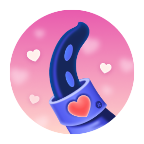 | Heart On Your Sleeve | (Em teste) Reaja a algo no GitHub com um emoji ❤️ | <table>  <thead>  <tr>  <th>PADRÃO</th> <th>BRONZE</th>  <th>PRATA</th>  <th>OURO</th>  </tr>  </thead>  <tbody>  <tr>  <td align="center"></td>   <td align="center">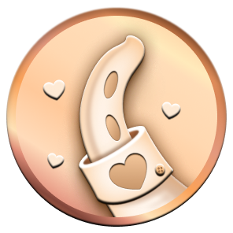</td>  <td>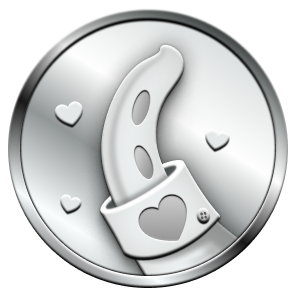</td>  <td align="center">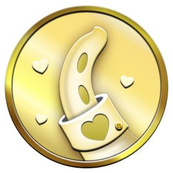</td>  </tr>  <tr>  <td align="center">(?)</td>  <td align="center">(?)</td>  <td align="center">(?)</td>  <td align="center">(?)</td>  </tr>   </tbody>  </table> |
| 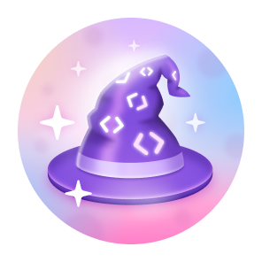 | Open Sourcerer | (Em teste) O usuário teve Pull Requests merged em vários repositórios públicos | <table>  <thead>  <tr>  <th>DEFAULT</th> <th>BRONZE</th>  <th>SILVER</th>  <th>GOLD</th>  </tr>  </thead>  <tbody>  <tr>  <td align="center"></td>   <td>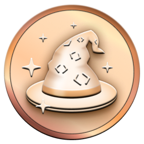</td>  <td align="center"></td>  <td align="center">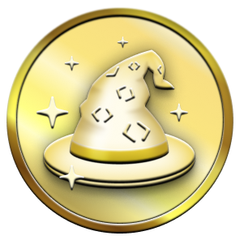</td>  </tr>  <tr>  <td align="center">(?)</td>  <td align="center">(?)</td>  <td align="center">(?)</td>  <td align="center">(?)</td>  </tr>   </tbody>  </table> |
| 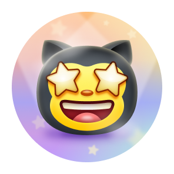                 | Starstruck         | Criou um repositório que tem muitas (16) estrelas | <table>  <thead>  <tr>  <th>DEFAULT</th> <th>BRONZE</th>  <th>SILVER</th>  <th>GOLD</th>  </tr>  </thead>  <tbody>  <tr>  <td align="center"></td>   <td align="center">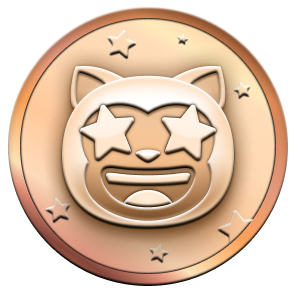</td>  <td align="center">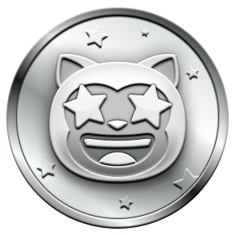</td>  <td>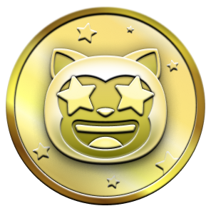</td>  </tr>  <tr>  <td align="center">16</td>  <td align="center">128</td>  <td align="center">512</td>  <td align="center">4096</td>  </tr>   </tbody>  </table>      |
| 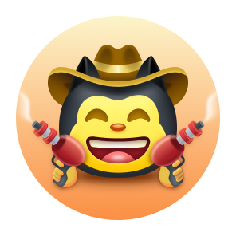                 | Quickdraw        | Gitty up! (fechou uma issue / pull request dentro de 5 minutos após a abertura) | <table>  <thead>  <tr>  <th>DEFAULT</th>  </tr>  </thead>  <tbody>  <tr>  <td align="center"></td> </tr>  <tr>  <td align="center">1</td> </tr>   </tbody>  </table> |
| 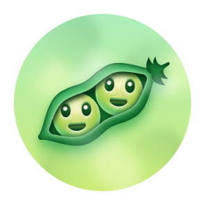     | Pair Extraordinaire  | [Coautoria](https://docs.github.com/pull-requests/committing-changes-to-your-project/creating-and-editing-commits/creating-a-commit-with-multiple-authors) em commits de merged pull request | <table>  <thead>  <tr>  <th>DEFAULT</th> <th>BRONZE</th>  <th>SILVER</th>  <th>GOLD</th>  </tr>  </thead>  <tbody>  <tr>  <td align="center"></td>   <td align="center">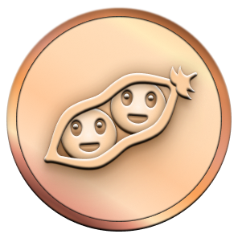</td>  <td>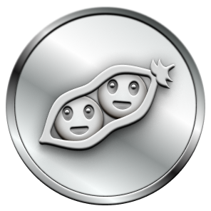</td>  <td>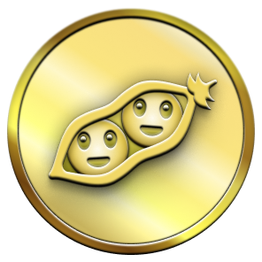</td>  </tr>  <tr>  <td align="center">1</td>  <td align="center">10</td>  <td align="center">24</td>  <td align="center">48</td>  </tr>   </tbody>  </table>      |
| 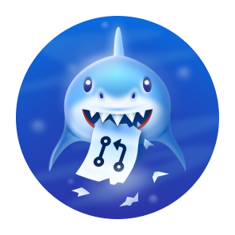     | Pull Shark  | Abriu 2 Pull Requests que foram merged | <table>  <thead>  <tr>  <th>DEFAULT</th> <th>BRONZE</th>  <th>SILVER</th>  <th>GOLD</th>  </tr>  </thead>  <tbody>  <tr>  <td align="center"></td>   <td>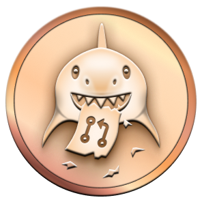</td>  <td>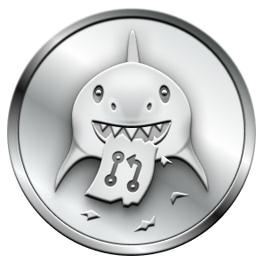</td>  <td>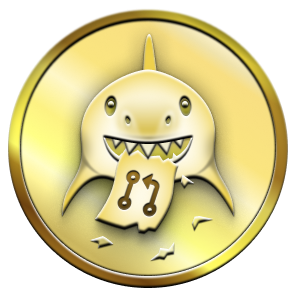</td>  </tr>  <tr>  <td align="center">2</td>  <td align="center">16</td>  <td align="center">128</td>  <td align="center">1024</td>  </tr>   </tbody>  </table>      |
| 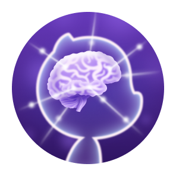 | Galaxy Brain | Respondeu 2 discussões  (e teve 2 respostas aceitas) | <table>  <thead>  <tr>  <th>DEFAULT</th> <th>BRONZE</th>  <th>SILVER</th>  <th>GOLD</th>  </tr>  </thead>  <tbody>  <tr>  <td align="center"></td>  <td align="center">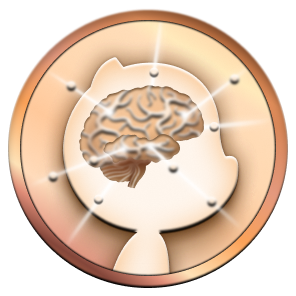</td>  <td align="center"></td>  <td align="center"></td>  </tr>  <tr>  <td align="center">2</td> <td align="center">8</td>  <td align="center">16</td>  <td align="center">32</td>  </tr>   </tbody>  </table>
| 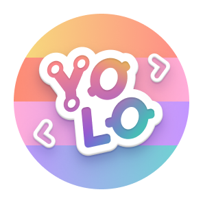                 | YOLO        | Merged uma pull request sem uma revisão | <table>  <thead>  <tr>  <th>DEFAULT</th>  </tr>  </thead>  <tbody>  <tr>  <td align="center"></td> </tr>  <tr>  <td align="center">1</td> </tr>   </tbody>  </table> |
|                  | Public Sponsor        | Patrocinou um contribuidor de código aberto através do [GitHub Sponsors](https://github.com/sponsors) | <table>  <thead>  <tr>  <th>DEFAULT</th>  </tr>  </thead>  <tbody>  <tr>  <td align="center"></td> </tr>  <tr>  <td align="center">1</td> </tr>   </tbody>  </table> |

 

# 👋 Tom de Pele da Conquista 👋

#### A aparência de algumas conquistas depende da sua preferência do Tom de Pele do Emoji.

#### Você pode mudar o Tom de Pele em [appearance settings](https://github.com/settings/appearance).

 

| Badge | Nome | Versão do Tom de Pele | 
| :-: | :-: | :-: |
|                  | Starstruck         | <table>  <thead>  <tr>  <th>👋</th> <th>👋🏻</th>  <th>👋🏼</th>  <th>👋🏽</th>  <th>👋🏾</th>  <th>👋🏿</th>  </tr>  </thead>  <tbody>  <tr>  <td align="center"></td>   <td align="center">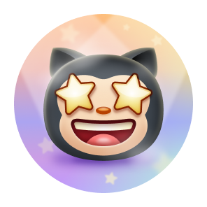</td>  <td align="center">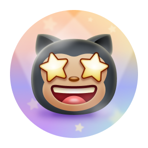</td>  <td align="center">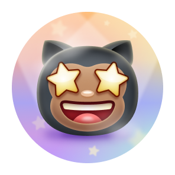</td>  <td align="center">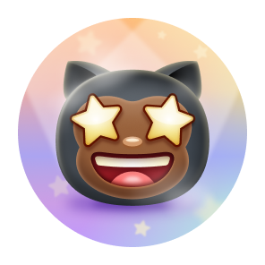</td>   <td align="center">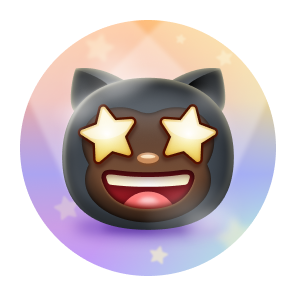</td>   </tr>   <tr>  <td align="center">👋</td> <td align="center">👋🏻</td>  <td align="center">👋🏼</td>  <td align="center">👋🏽</td>  <td align="center">👋🏾</td>  <td align="center">👋🏿</td>  </tr>  </tbody>  </table>      |
|                  | Quickdraw         | <table>  <thead>  <tr>  <th>👋</th> <th>👋🏻</th>  <th>👋🏼</th>  <th>👋🏽</th>  <th>👋🏾</th>  <th>👋🏿</th>  </tr>  </thead>  <tbody>  <tr>  <td align="center"></td>   <td align="center">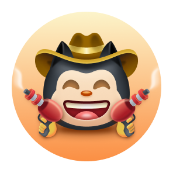</td>  <td align="center">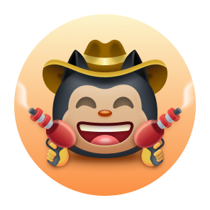</td>  <td align="center">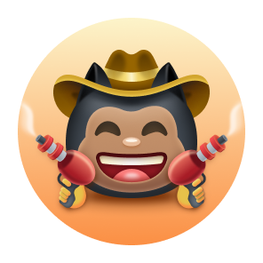</td>  <td align="center">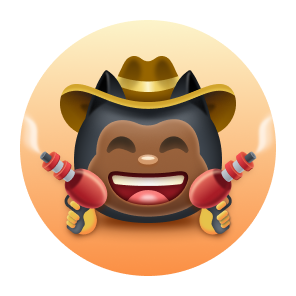</td>   <td align="center">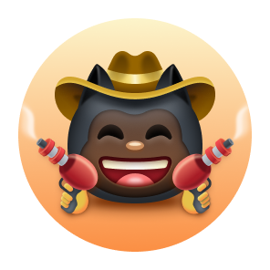</td>   </tr>   <tr>  <td align="center">👋</td> <td align="center">👋🏻</td>  <td align="center">👋🏼</td>  <td align="center">👋🏽</td>  <td align="center">👋🏾</td>  <td align="center">👋🏿</td>  </tr>  </tbody>  </table>      |

 

# ❌ Badges que não podem mais ser obtidas ❌
 

| Badge | Nome | Como conseguir | Quantidade necessária | 
| :-: | :-: | :-: | :-: |
|      | Mars 2020 Contributor  | Contribuiu no repositório usado no [Mars 2020 Helicopter Mission](https://github.com/readme/featured/nasa-ingenuity-helicopter) | <table>  <thead>  <tr>  <th>DEFAULT</th>  </tr>  </thead>  <tbody>  <tr>  <td align="center"></td> </tr>  <tr>  <td align="center">1</td> </tr>   </tbody>  </table> |
|  | Arctic Code Vault Contributor | Contribuiu no repositório do [2020 GitHub Archive Program](https://archiveprogram.github.com/) | <table>  <thead>  <tr>  <th>DEFAULT</th>  </tr>  </thead>  <tbody>  <tr>  <td align="center"></td> </tr>  <tr>  <td align="center">1</td> </tr>   </tbody>  </table> |

 

# 🏅 Exibição de Conquistas 🏅

#### Exibir conquistas em seu perfil é totalmente opcional; por padrão, elas podem ser vistas por qualquer pessoa que visualize seu perfil público.

#### Você pode cancelar a exibição das conquistas em seu perfil acessando suas [configurações de perfil](https://github.com/settings).

 

# ℹ️ Mais informações ℹ️

#### Você pode achar mais informações sobre as Badges do GitHub neste [link](https://docs.github.com/en/account-and-profile/setting-up-and-managing-your-github-profile/customizing-your-profile/personalizing-your-profile#displaying-badges-on-your-profile) e neste outro [link](https://github.blog/2022-06-09-introducing-achievements-recognizing-the-many-stages-of-a-developers-coding-journey) também!

 
 
 

# 🌍 Veja também 👀 

- <a href="https://Flet/rejected-github-profile-achievements">Flet/rejected-github-profile-achievements</a> para rir sobre as Conquistas ("the Achievements")
- <a href="https://github.com/Schweinepriester/github-profile-achievements"> Schweinepriester/github-profile-achievements</a> igual, só que diferente ;)  
- <a href="https://github.com/MayconCoutinho/GitHub-Trofeu-de-Conquistas"> MayconCoutinho/GitHub-Trofeu-de-Conquistas</a> uma versão brasileira  
- *Este repositório foi criado, inspirado e melhorado a partir dos repositórios acima e principalmente deste outro: <a href="https://github.com/drknzz/GitHub-Achievements"> drknzz/GitHub-Achievements</a>

